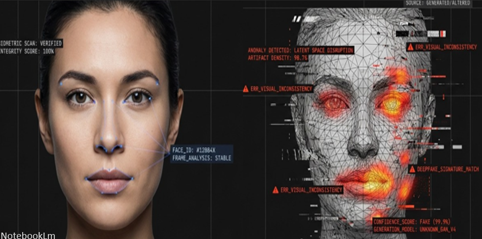
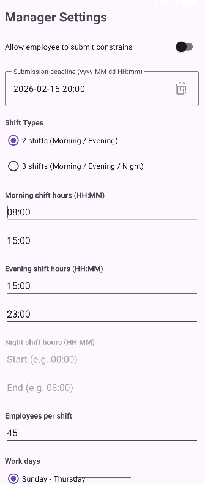
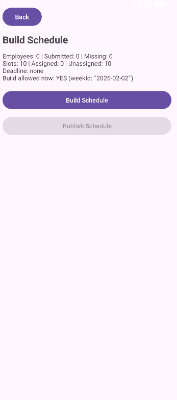

<h1 align="center">Hi 👋 I'm Menaluc</h1>

    <strong>Final-year Computer Science student</strong> 
    Backend Developer in progress • AI • Real-world systems

---

## About Me

I’m a final-year Computer Science student with a strong interest in backend development and practical AI systems.

I enjoy building end-to-end projects that connect models, APIs, and product thinking into real applications.

- Backend-focused, currently strengthening **Node.js**
- Experience in **Machine Learning** and **Deep Learning**
- Interested in building systems from **model → API → product**
- Fast learner with a strong problem-solving mindset

---

## Tech Stack

    

---

## Featured Projects

### RealVision Backend - Video Upload & Prediction API

    

    <strong>Backend system for uploading videos and returning deepfake predictions</strong>

- Built a **Node.js REST API** for video upload and prediction flow
- Designed to connect a trained deepfake detection model to a usable backend system
- Focused on turning an AI project into a practical application layer

---

### MyShiftApp - Shift Management System

    
    

    <strong>Android-based system for managing employee constraints and schedule generation</strong>

- Developed a **role-based Android application** in Java
- Employees submit availability and constraints
- Managers monitor status and run schedule generation flow
- Built with **Firebase Authentication** and **Cloud Firestore**

---

### RealVision - Deepfake Detection System

    <strong>Team-based AI project for deepfake video classification and explainability</strong>

- Deepfake detection model for **Real vs Fake** classification
- Combined **Computer Vision** and **Deep Learning**
- Applied **Grad-CAM** for model interpretability
- Built as part of a collaborative project

---

## Career Goal

I’m looking for a **junior backend / software developer role** where I can continue learning, grow through real
engineering work, and contribute to practical systems.

---

    

